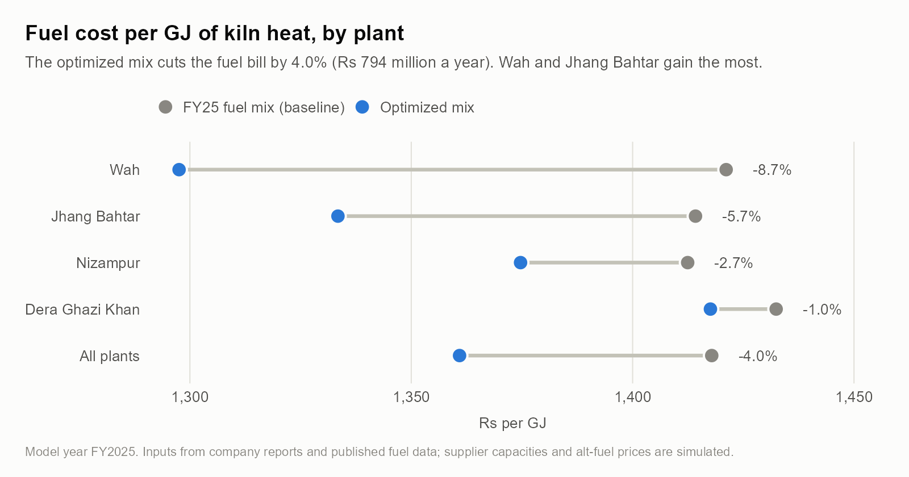
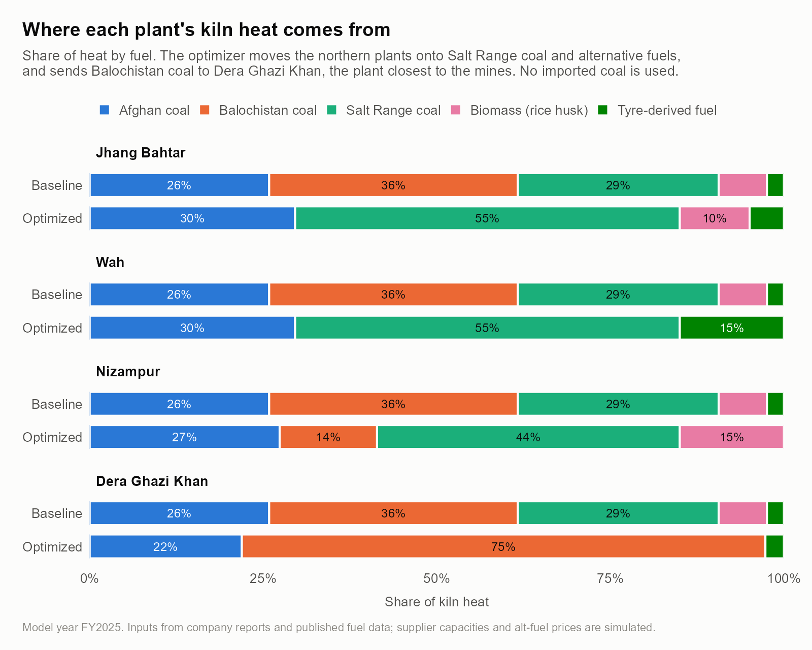
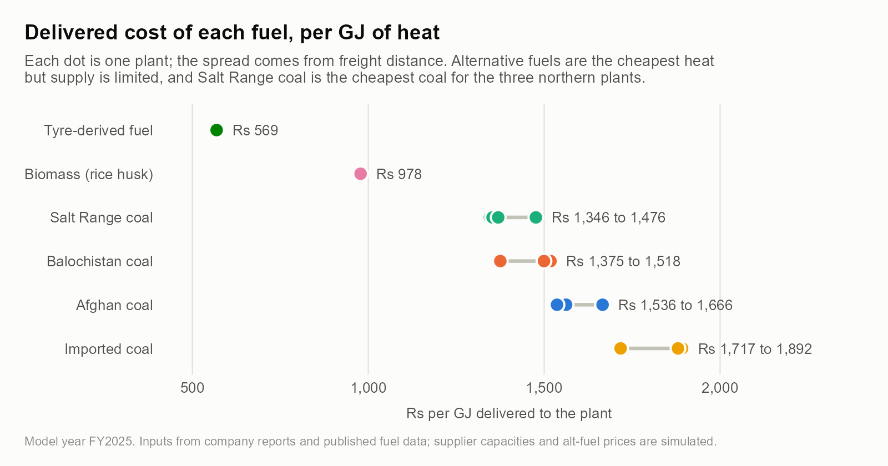
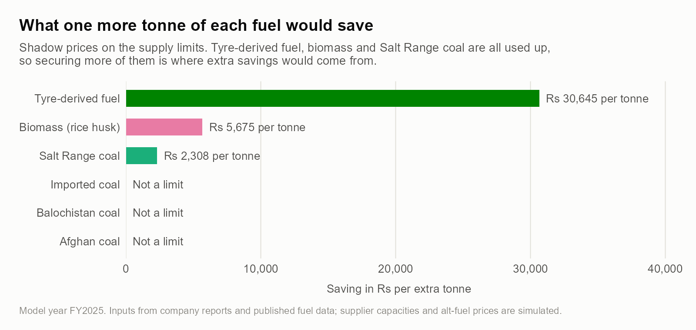
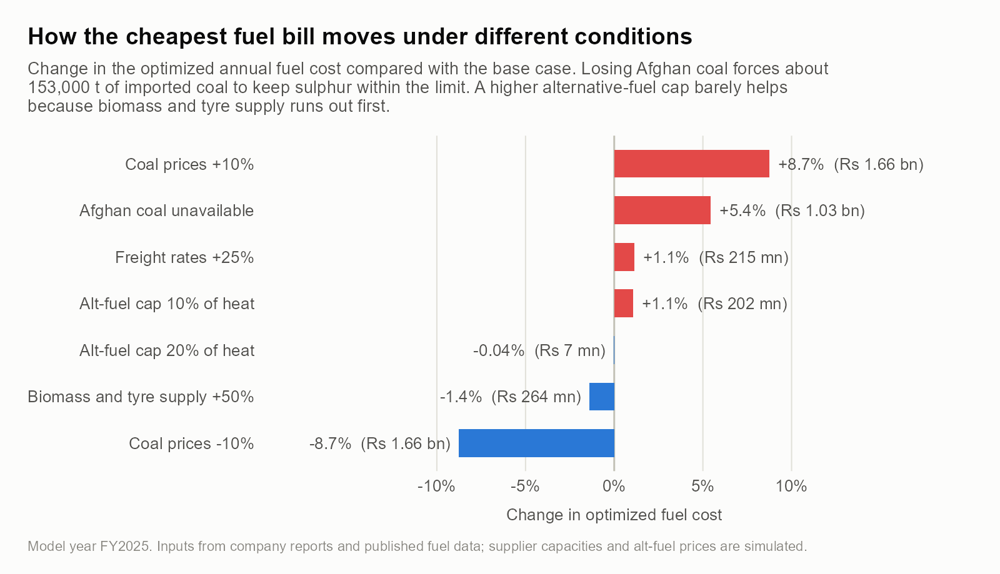
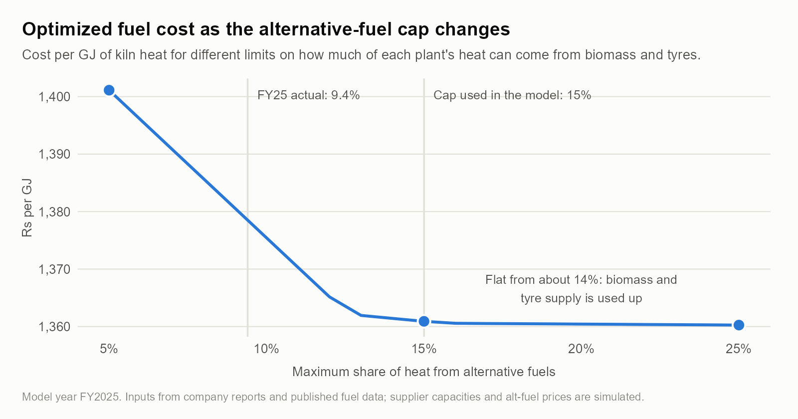

# Cost Optimization with Linear Programming

**Choosing the cheapest kiln-fuel mix across a cement producer's four plants (FY2025)**

A cement kiln needs a fixed amount of heat for every tonne of clinker, and the producer can get that heat from several coals and from alternative fuels such as rice husk and shredded tyres. Each fuel has a different price, energy content and sulphur level, and each plant sits at a different distance from each source. I wanted to see how much cheaper the fuel bill could be if every plant bought the right mix, instead of all four plants using the same company-wide mix.

I built a linear program in R for a listed Pakistani cement producer with four plants in Punjab and Khyber Pakhtunkhwa, using figures from its published reports and analyst briefings plus published fuel-quality data. The same model is also rebuilt in Excel Solver, and the solution is checked with a second solver.



## Results

| | FY25 fuel mix (baseline) | Optimized mix |
|---|---:|---:|
| Annual fuel cost | Rs 19.76 bn | Rs 18.97 bn |
| Cost per GJ of kiln heat | Rs 1,418 | Rs 1,361 |
| Alternative fuels, share of heat | 9.4% | 12.6% |
| Imported coal | 0 t | 0 t |

- **Rs 794 million a year cheaper (4.0%)** for the same 13.9 million GJ of kiln heat, without making the coal blend any higher in sulphur.
- **About 60% of the saving (Rs 472 mn) comes from moving coal between plants.** Salt Range coal goes to the three northern plants, which are close to the mines. Most of the Balochistan coal goes to Dera Ghazi Khan, the plant nearest to Balochistan. The other Rs 322 mn comes from burning more biomass and tyre fuel.
- **The gain is uneven:** Wah saves 8.7% and Jhang Bahtar 5.7%, while Dera Ghazi Khan saves only 1.0%. The coal closest to it is high in sulphur, so it still needs Afghan coal hauled a long way, and the limited alternative fuel is worth more at the northern plants.
- **No imported coal is worth buying.** Even with the low-sulphur advantage, it costs Rs 1,717 to 1,892 per GJ delivered, against Rs 1,346 to 1,518 for local coal.



The reason is clear when every fuel is put on the same basis, cost per GJ of heat delivered to the plant:



### Which limits matter

The constraints that bind at the optimum show where the next rupee of savings would come from. The coal-blend sulphur limit binds at all four plants, and the 15% alternative-fuel cap binds at the three northern plants. Supply binds for Salt Range coal, biomass and tyre fuel. The shadow prices put a value on each one:



One more tonne of tyre-derived fuel would cut the bill by about Rs 30,600, and one more tonne of biomass by about Rs 5,700. An extra GJ of heat costs Rs 1,441 at Dera Ghazi Khan and Rs 1,491 to 1,498 at the northern plants.

## Scenarios

The base case uses FY2025 prices and supply. `R/05_scenarios.R` re-solves the model with one input changed at a time:



| Scenario | Optimized cost | Change vs base | Saving vs FY25 mix at the same prices |
|---|---:|---:|---:|
| Base case | Rs 18.97 bn | | 4.0% |
| Afghan coal unavailable | Rs 20.00 bn | +5.4% | not comparable* |
| Coal prices +10% | Rs 20.63 bn | +8.7% | 3.9% |
| Coal prices −10% | Rs 17.31 bn | −8.7% | 4.1% |
| Freight rates +25% | Rs 19.18 bn | +1.1% | 4.7% |
| Alternative-fuel cap 10% of heat | Rs 19.17 bn | +1.1% | 3.0% |
| Alternative-fuel cap 20% of heat | Rs 18.96 bn | −0.04% | 4.1% |
| Biomass and tyre supply +50% | Rs 18.70 bn | −1.4% | 5.4% |

\* The FY25 mix is 25% Afghan coal, so it can't be used as a comparison once that coal is gone.

A few things stand out:

- **Losing Afghan coal adds Rs 1.03 bn a year (+5.4%).** This one actually happened: the Pakistan-Afghanistan border was closed in October 2025 and Afghan coal stopped coming in. Local coals are high in sulphur (4.9 to 5.3%), so the model has to bring in about 153,000 t of low-sulphur imported coal to stay within the limit.
- **The saving holds up when prices move,** and it grows when freight gets more expensive, because sending each plant its nearest coal matters more.
- **Raising the alternative-fuel cap barely helps.** Biomass and tyre supply runs out before the cap is reached. The sweep below shows the cost flattening from about 14%.



## The model

For fuel source $i$ (six sources) and plant $j$ (four plants), the decision variable $x_{ij}$ is the tonnes of fuel $i$ delivered to plant $j$ in a year. That gives 24 variables and 18 constraints.

$$
\min \sum_{i}\sum_{j} c_{ij}\, x_{ij}
$$

subject to

$$
\begin{aligned}
\textstyle\sum_i e_i\, x_{ij} &\ge H_j && \text{heat demand at each plant} \\
\textstyle\sum_{i \in \text{coal}} (s_i - \bar{S})\, x_{ij} &\le 0 && \text{coal blend no higher in sulphur than the FY25 blend} \\
\textstyle\sum_{i \in \text{alt}} e_i\, x_{ij} &\le \tau \textstyle\sum_i e_i\, x_{ij} && \text{alternative fuels at most } \tau \text{ of the heat} \\
\textstyle\sum_j x_{ij} &\le Q_i && \text{supply available from each source} \\
x_{ij} &\ge 0
\end{aligned}
$$

| Symbol | Meaning | Value |
|---|---|---|
| $c_{ij}$ | delivered cost: price at origin plus road freight (Rs/t) | from `data/model_inputs/routes.csv` |
| $e_i$ | net calorific value of the fuel (GJ/t) | 12.3 (rice husk) to 35.2 (tyres) |
| $H_j$ | kiln heat needed at plant $j$ (GJ/yr) | 13.9 million GJ in total |
| $s_i$, $\bar{S}$ | sulphur content of the fuel; limit for the coal blend (%) | limit 4.03% |
| $\tau$ | maximum share of heat from alternative fuels | 15% |
| $Q_i$ | supply available from source $i$ (t/yr) | simulated |

Heat demand comes from FY25 production: clinker = cement × 95% − supplementary materials = 4.60 Mt, and kiln heat = 3.03 GJ per tonne of clinker (724 kcal/kg). This is split across plants by capacity. Freight is road distance × Rs 6.92 per tonne-km, calibrated to a published Karachi-to-north coal freight rate.

The **baseline** applies the FY25 disclosed mix at every plant. Alternative fuels give 9.4% of the heat, and coal is 25% Afghan and 75% local by mass. Its cost is Rs 19.76 bn, 7.8% below the fuel cost in the company's accounts (Rs 21.44 bn, from nine months annualised). That's close enough for a model that leaves out handling, storage and quality penalties.

### Checks

- `R/03_verify_solution.R` rebuilds the LP cell by cell and solves it with GLPK. The minimum cost matches lp_solve to within 10⁻¹¹.
- It also adds 1,000 t of biomass and 1,000 GJ of heat demand and confirms that the change in cost matches the shadow prices.
- Every constraint is reported for both the baseline and the optimum in `results/constraints_*.csv`.
- `excel/cost_optimization_model.xlsx` is the same model in Excel Solver, with inputs in blue, formulas in black and a cell that shows the difference from the R optimum. The README sheet inside explains how to rerun Solver.

## Data

Every number in `data/` has a source ID and one of four tags:

| Tag | Meaning |
|---|---|
| V | Verified: published by the company, a regulator or a journal |
| C | Calculated from verified values (the formula is in the file) |
| A | Assumption I chose, such as the PKR/USD rate or the 15% alternative-fuel cap |
| S | Simulated, because the real figure isn't public |

The simulated values are the supply limits for each source and the delivered prices of biomass and tyre fuel. The coal qualities are published values for each coal type, not the company's actual purchases. The full list of sources, with links, is in [`references/sources.md`](references/sources.md), and the definitions are in [`data/data_dictionary.csv`](data/data_dictionary.csv) and [`data/README.md`](data/README.md).

## Running it

You need R 4.x. In RStudio, open `cost-optimization-linear-programming.Rproj`, then:

```r
source("install_packages.R")   # once
source("run_all.R")
```

Or from a terminal in the project folder: `Rscript run_all.R`. The whole run takes about 15 seconds:

| Step | Script | Output |
|---|---|---|
| 1 | `R/01_build_dataset.R` | all model inputs in `data/` |
| 2 | `R/02_optimization_model.R` | optimum, constraints, shadow prices in `results/` |
| 3 | `R/03_verify_solution.R` | independent check with GLPK |
| 4 | `R/04_build_excel.R` | `excel/cost_optimization_model.xlsx` |
| 5 | `R/05_scenarios.R` | `results/scenarios.csv`, `results/sensitivity_alt_fuel_cap.csv` |
| 6 | `R/06_charts.R` | `results/figures/*.png` |

## Limitations

- It's a one-year, linear model: no volume discounts, no stockpiles, no month-to-month changes in price or supply.
- Supply limits and alternative-fuel prices are simulated, so the size of the saving depends on them. The scenarios show how much.
- Plant locations are town-level coordinates, and road distance is straight-line distance × 1.3.
- Heat demand is split by capacity, which assumes all four plants ran at the same utilization.
- The sulphur rule only stops the blend getting worse than FY25. It is not a regulatory or kiln-chemistry limit, and ash and chlorine aren't modeled.

This is an independent project built from public information. It isn't affiliated with or endorsed by the company, and the optimized mix is not its actual procurement plan.

## License

The code is MIT licensed (see [`LICENSE`](LICENSE)). Figures quoted from published reports belong to their publishers.

## Author

Abdul Haseeb Khan, BS Business Economics, University of the Punjab. Questions and corrections are welcome; the easiest way is to open an issue.
